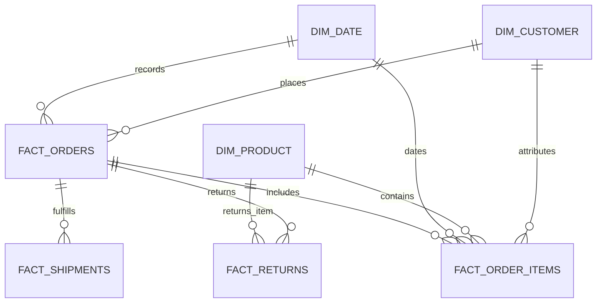

# Dimensional Model & Data Dictionary

## 1. Dimensional Architecture Overview
The `CURATED` layer follows Kimball dimensional modeling principles. It consists of conforming dimension tables and transaction-level fact tables linked via surrogate keys (`MD5` hashes).

---

## 2. Dimensions

### `CURATED.DIM_DATE`
- **Granularity**: 1 row per calendar day.
- **Key**: `date_key` (Numeric `YYYYMMDD`, e.g., `20240501`).
- **Attributes**: `calendar_date`, `year_num`, `quarter_name`, `month_num`, `month_name`, `day_of_month`, `day_name`, `is_weekend`.

### `CURATED.DIM_CUSTOMER`
- **Granularity**: 1 row per unique customer.
- **Surrogate Key**: `customer_key` (`MD5(customer_id)`).
- **Natural Key**: `customer_id_nk`.
- **Attributes**: `first_name`, `last_name`, `full_name`, `email`, `phone`, `address`, `city`, `state`, `zip_code`, `country`, `signup_date`.

### `CURATED.DIM_PRODUCT`
- **Granularity**: 1 row per unique product SKU.
- **Surrogate Key**: `product_key` (`MD5(product_id)`).
- **Natural Key**: `product_id_nk`.
- **Attributes**: `product_name`, `category`, `subcategory`, `unit_cost`, `unit_price`, `unit_margin`, `gross_margin_pct`, `sku`, `is_active`.

---

## 3. Fact Tables

### `CURATED.FACT_ORDERS`
- **Granularity**: 1 row per customer order transaction.
- **Surrogate Key**: `order_key` (`MD5(order_id)`).
- **Foreign Keys**: `customer_key`, `order_date_key`.
- **Measures**: `total_amount`, `shipping_fee`, `tax_amount`, `net_sales_amount`.
- **Degenerate Dimensions**: `order_status`, `channel`, `payment_method`.

### `CURATED.FACT_ORDER_ITEMS`
- **Granularity**: 1 row per line-item ordered.
- **Surrogate Key**: `order_item_key` (`MD5(order_item_id)`).
- **Foreign Keys**: `order_key`, `product_key`, `customer_key`, `order_date_key`.
- **Measures**: `quantity`, `unit_price`, `discount_amount`, `gross_line_total`, `calculated_line_total`, `total_cost`, `gross_profit`.

### `CURATED.FACT_SHIPMENTS`
- **Granularity**: 1 row per carrier shipment package.
- **Surrogate Key**: `shipment_key` (`MD5(shipment_id)`).
- **Foreign Keys**: `order_key`, `shipped_date_key`, `delivered_date_key`.
- **Measures / SLAs**: `transit_days`, `is_on_time_delivery`.
- **Attributes**: `shipping_carrier`, `tracking_number`, `shipment_status`.

### `CURATED.FACT_RETURNS`
- **Granularity**: 1 row per item return event.
- **Surrogate Key**: `return_key` (`MD5(return_id)`).
- **Foreign Keys**: `order_key`, `product_key`, `return_date_key`.
- **Measures**: `refund_amount`.
- **Attributes**: `return_reason`, `return_status`.
